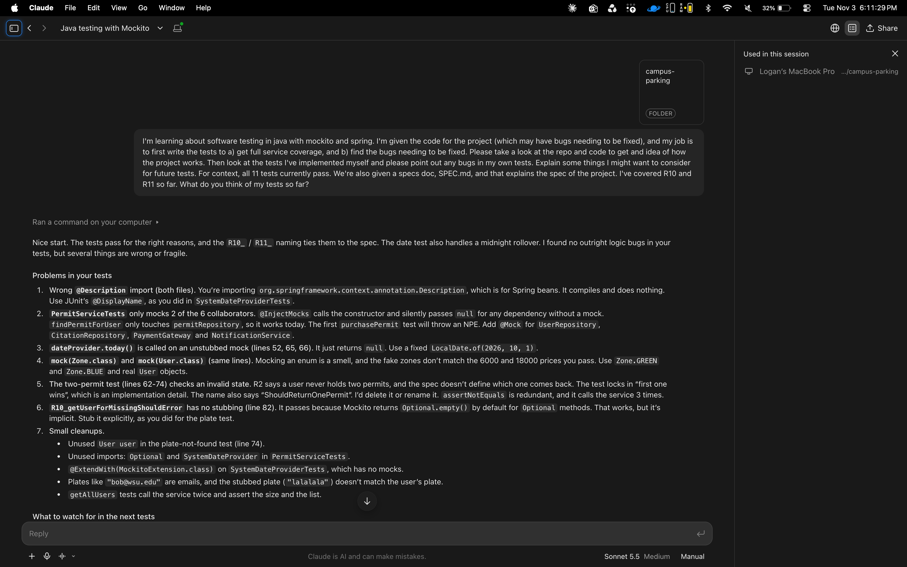
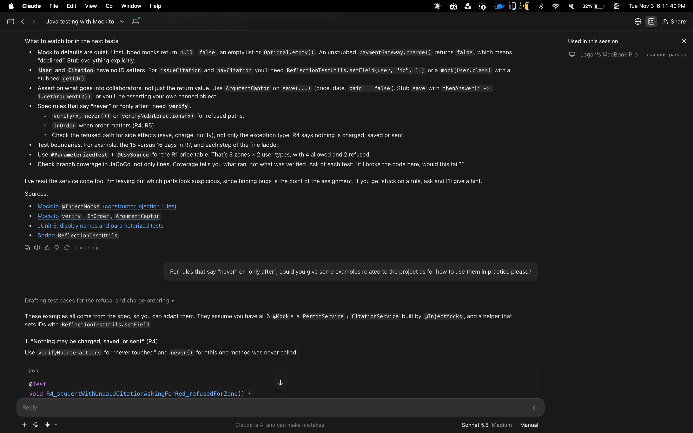
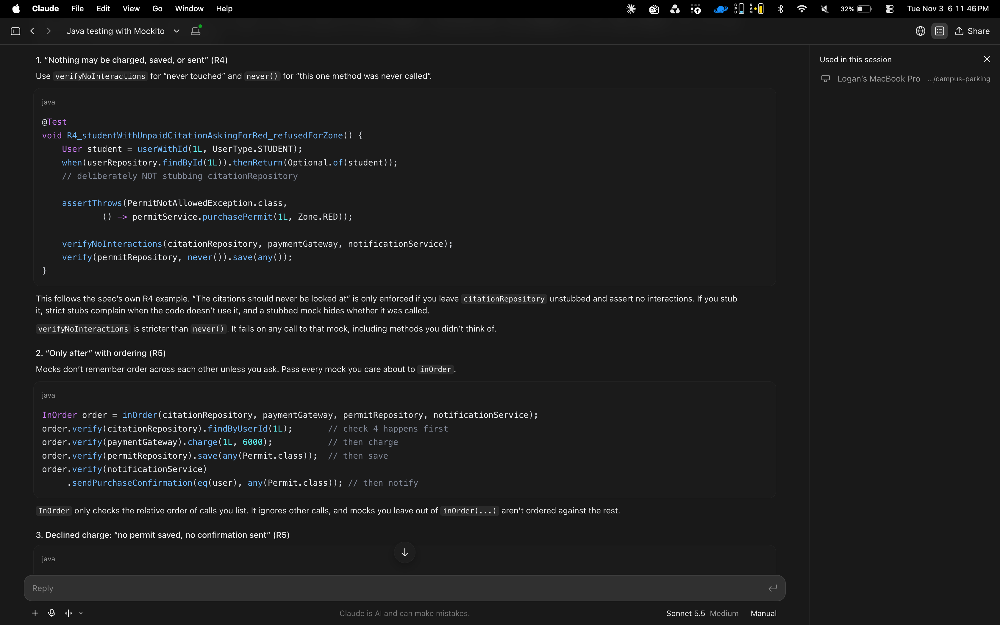
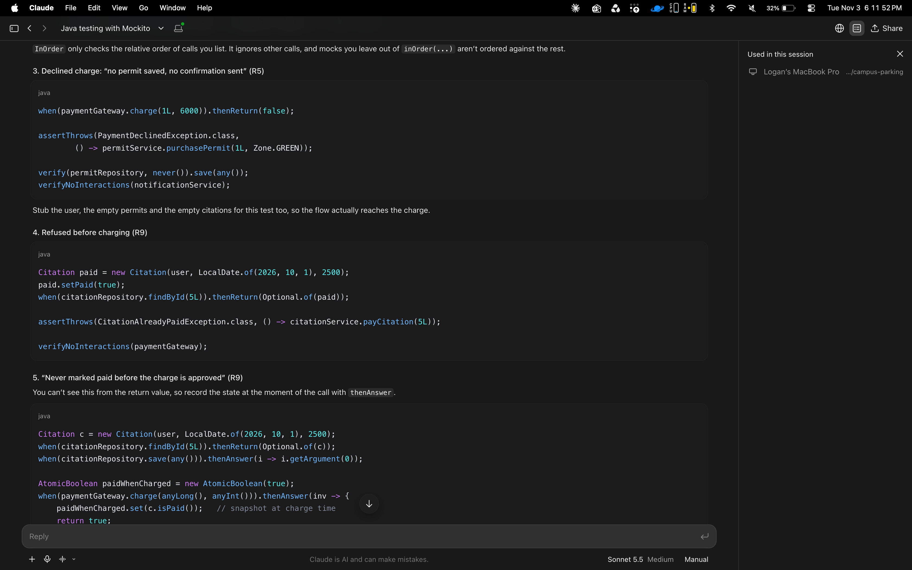
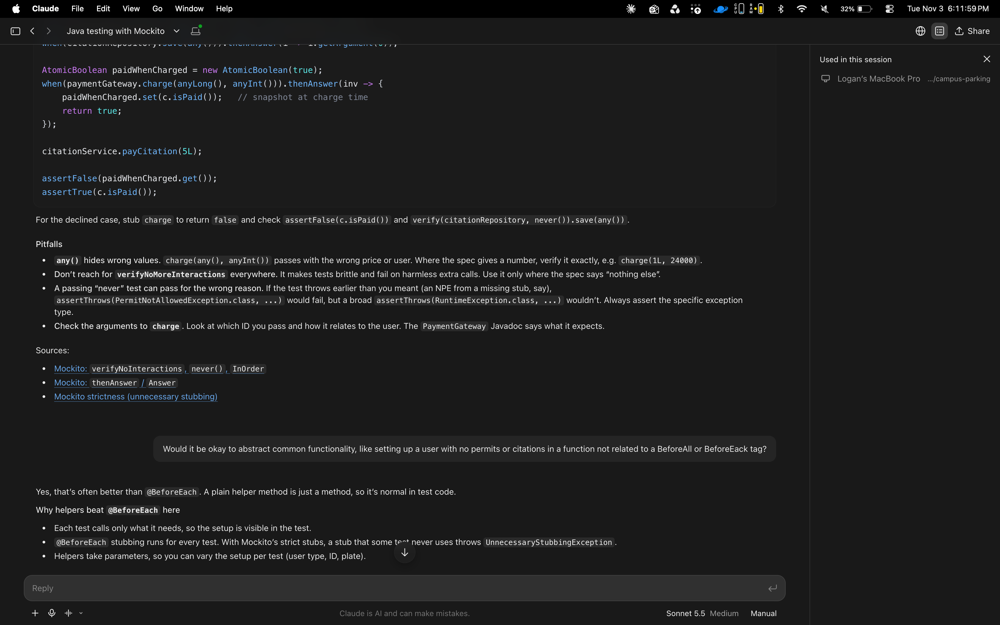
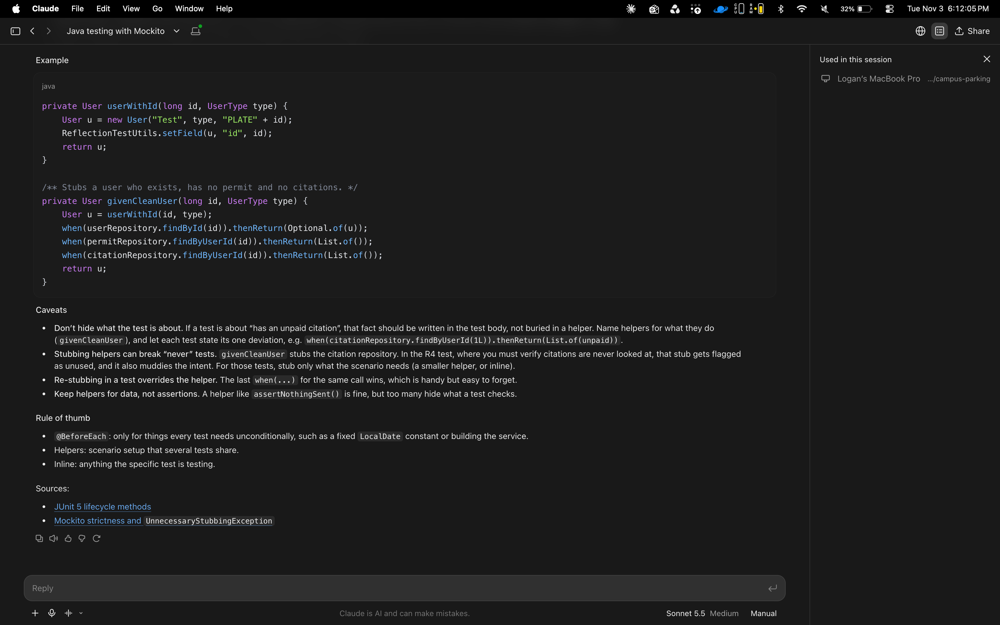
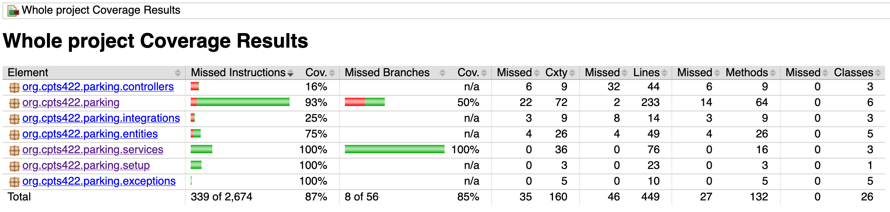
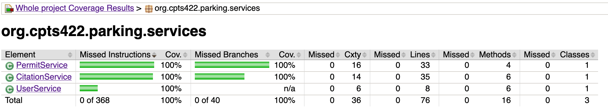
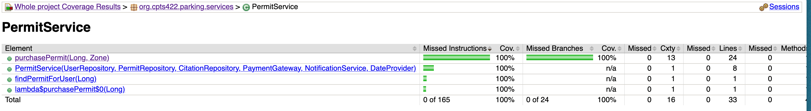
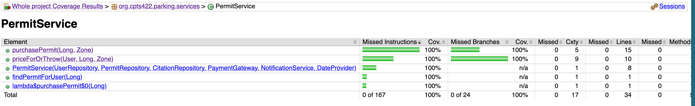

# MidTerm 2 - Campus Parking

> **Programmer:** Logan Meyers
> 
> **Date Completed:** Nov 3rd, 2026
>
> **Class:** CptS 422 - Software Testing
>
> **Instructor:** Subu

---

**Readme requirements, right here:**
- **HTML Coverage Report:** At the root of the folder, in `htmlReport/`. Created with JaCoCo.
- **Faults Found:** I found x faults, and more can be found in the [Faults](#Faults) section
- **Refactored Methods:** I refactored 1 method, `purchasePermit`. See the [Refactoring](#refactoring) section
- **AI Used:** Claude
- **AI Screenshots:** at the root of the folder, in `ai-log/`, or see them in order at the [AI Screenshots](#ai-screenshots) section below
- **Coverage Screenshots:** I have screenshots in the `coverageScreenshots/` folder at the root, or you can see them at the [Coverage Screenshots](#coverage-screenshots)

---

### Solution Report

I wanted to add to the readme to explain a little about my process for completing the midterm programming section. Since I did HomeWork 2, everything was pretty familiar. My AI usage for learning most of the basics can be found there.

I started the midterm by reading the spec like asked, and starting to write some tests. All tests for `SystemDateProvider`, `UserService`, and `PermitProvider` I wrote myself. I covered R10 and R11. I used Claude to give feedback about things I missed and things to look out for. The first two screenshots show our interaction. It noticed errors with `description`, which I used accidentally instead of `displayName`, and some issues with me hardcoding value like 6000 instead of using an enum and missing mocks.

I then implemented most of those changes into my current tests and went on to implement more of the tests. This includes R12, the last of the lookup rules.

A couple ways I used Claude was asking how to use checks like `verifyNoInteractions` in tests and whether abstracting common functionality (like making a clear uesr) is okay for testing. I used the info it gave me to help me make tests, but not necessarily just copy & paste, which is why my actual tests are different from what it gave me.

Then I went on to complete all Permit rules, R1-R5. After implementing those, I found a couple bugs. Some R1, R3, and R5 tests failed, because of the wrong ordering. I went to PermitService and fixed Faults F1 and F2.

I then went on to the Citation rules, R6-R9. After implementing those, I found 4 tests failing. R7 and R9 were affected. The easiest to fix was F3, which made one test pass. Then next was F4, super easy. Next was R9, which I fixed both failing tests with a single replacement. One of the tests failed with 7L used instead of 1L for charging the user, which told me the wrong ID was passed. Look at my fix for F5 for more!

At this point, all 41 tests pass and I've fixed 5 separate bugs in the code. Covered classes and functions were 100%, but I had 93% branch coverage for CitationService, from `issueCitation`'s check on line 52. I added one test, `R7_mostRecentPreviousCitationShouldDecideFineWhenListedOldestFirst` to cover the last 1/4 of the branches possible there.

All tests done and on to refactoring.

---

### Refactoring

I chose to refactor PermitService's `purchasePermit` since it had a CXTY of 13. All I did was abstract out the code for setting the price. This was enough to bring the CXTY for `purchasePermit` down to 5, and the new function for setting the price or erroring, `priceForOrThrow`, is 9.

### Faults

| Fault ID | Rule ID | Test | Fix Desc. |
| --- | --- | --- | --- |
| F1 | R1 | R1_allowedZoneShouldChargeFixedPriceForType | Changing the price returned for EMPLOYEE and GREEN from 6000 to 9000 |
| F2 | R3 & R5 | R3_userWithUnpaidCitationShouldBeRefused & R5_declinedChargeShouldNotSaveOrSend | Simply moving for-loop checking citations for a user to before the payment check fixes both tests and solves the issue. |
| F3 | R7 | R7_repeatCitationShouldMoveByDaysSincePrevious | Changing the bound of the check from `>=` to just `>` to mean "15 days or fewer" |
| F4 | R7 | R7_paidPreviousCitationShouldStillCount | Simply removing the check for is citation wasn't paid solves the issue, since we want to check for ANY citatios not just unpaid ones to raise the charge. |
| F5 | R9 | R9_approvedChargeShouldMarkPaidSaveAndReturn & R9_declinedChargeShouldLeaveCitationUnpaid | Fixed by replacing the `citationId` with `citation.getUser().getId()`, passing in the right id |

----

### AI Screenshots

Below is the conversation I had with Claude, in order:

---

### Coverage Screenshots

Below are my coverage screenshots:

**Before Refactor:**

**After Refactor:** (Just PermitService changed)

