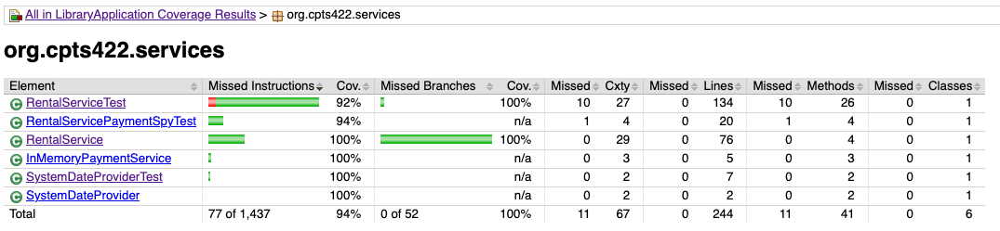

# HomeWork 2 - Library Application

**Coverage Report:**

Located at `coverage-report/` at the root of this project directory

**Refactor:**

The code started at the following complexities from the report:
- `rentBook`: 11
- `calculateLateFee`: 12
- `returnBook`: 5

I pulled the logic for checking if a user existed, a book existed, and the daily cents calculation of of each function it applied to, and I was able to lower the complexities down to:
- `rentBook`: 9
- `calculateLateFee`: 7
- `returnBook`: 3

I added 3 new private, static functions to make this happen:
- `dailyRateCents`: complexity of 6; performs the daily rate calculation given book type and user membership type
- `findUserOrThrow`: complexity of 2; tries to get a user, throws UserNotFoundException if no user found, otherwise returns the user object
- `findBookOrThrow`: complexity of 2; tries to get a book, throws BookNotFoundException if no book found, otherwise returns the book object

This simple logic abstraction make the code in the original 3 functions just a bit nice to read, and a lot easier to understand in opinion.

All 41 of my tests still pass.

**Screenshots:**

The screenshots can be found at the `Screenshosts/` folder, or you can view them below:

Project coverage:

RentalService coverage before refactor:

RentalService coverage _after_ refactor:

**AI:**

You can find the `ai-log.md` at the root of the project, where I had Claude output our conversations.

I used Claude Code in planning mode and let it view the project and the code I made, but edit no files other than the ai-log (at the time, chatlog.md before I renamed it for submission) 

I looked over the output and it looks pretty good. It summarized our conversations but it matches pretty well. You can see an example of the actual output and way I had it set up on my computer, here:

To who ever is grading this, I'll keep the thread in Claude Code in case you want a full non-summarized conversation, but I'd say the Claude Code summary is pretty accurate. Just let me know.